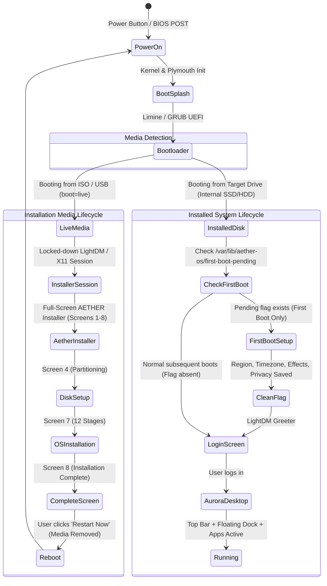

# AETHER OS — Boot Flow & Lifecycle Specification

## 1. Primary Requirement

AETHER OS enforces two strictly distinguished boot workflows:

1. **Installation Media Boot (ISO / USB):** Must NOT boot into a functional live desktop. The system boots directly into the full-screen **AETHER Installer**.
2. **Installed System Boot (Hard Drive / SSD):** Boots directly into the installed operating system, running the **First-Boot Setup Wizard** once, then presenting the LightDM login screen and the **AETHER Aurora Desktop**.

---

## 2. Comprehensive Boot State Machine



---

## 3. Installation Media Boot Flow (ISO / USB)

```
Power On
   │
   ▼
UEFI / BIOS Firmware (OVMF / Hardware)
   │
   ▼
AETHER Boot Splash (Plymouth 'aether' theme)
   │
   ▼
Bootloader Menu (Limine v2 / GRUB UEFI)
   │  Default Entry: "Install AETHER OS" (timeout: 5s)
   ▼
Kernel Initialization (boot=live live-media=removable aether.installer=1)
   │
   ▼
System Services & X11 Server Init
   │
   ▼
Desktop Setup Guard (/usr/lib/aether-os/desktop-setup)
   │  - Disables desktop icons
   │  - Prevents aether-top-bar and aether-dock from launching
   │  - Suppresses normal live desktop environment
   ▼
AETHER OS Installer (/usr/local/bin/aether-installer --fullscreen)
   │  - Screen 1: Welcome & Language
   │  - Screen 2: System Requirements Audit
   │  - Screen 3: Installation Strategy Selection
   │  - Screen 4: Disk & Partition Manager
   │  - Screen 5: User & Security Setup (SHA-512 crypt)
   │  - Screen 6: Review & Final Confirmation
   │  - Screen 7: Real-Time 12-Stage Installation Pipeline
   │  - Screen 8: Installation Complete & Prompt to Remove Media
   ▼
Reboot (systemctl reboot / hardware reset)
```

---

## 4. Installed System Boot Flow (Internal Storage)

```
Power On
   │
   ▼
UEFI Firmware NVRAM Boot Entry ("AETHER OS")
   │
   ▼
AETHER Boot Splash (Plymouth Theme)
   │
   ▼
Installed Bootloader (Limine Protocol v2 / GRUB)
   │
   ▼
Installed AETHER Kernel & Core System Runtime
   │
   ▼
LightDM Display Manager Init
   │
   ▼
First-Boot Check (/var/lib/aether-os/first-boot-pending)
   ├── Pending Flag Found (First Boot Only):
   │     Launch FirstBootWizard (/usr/local/bin/aether-firstboot)
   │     1. Confirm Region & Keyboard
   │     2. Select Timezone
   │     3. Review Network Connection
   │     4. Display Preferences & Scaling
   │     5. Choose Visual Effects Profile (Adaptive / Balanced / Lightweight)
   │     6. Privacy Settings Review
   │     7. Complete & Remove Pending Flag
   │
   └── Flag Not Found (Subsequent Normal Boots):
         Bypass First-Boot Wizard completely
   ▼
LightDM Greeter / Automatic Login
   │
   ▼
AETHER Aurora Desktop Environment
   │  - AETHER Top Bar active with status capsules
   │  - AETHER Floating Glass Dock active with smooth indicators
   │  - Native System Applications ready (Files, Settings, Store, Task Manager)
```

---

## 5. Troubleshooting & Rescue Environment

For maintenance and hardware diagnostics on uninstalled media without installing:

1. User selects **"AETHER OS (Troubleshooting & Rescue Console)"** from the bootloader menu (appends `aether.rescue=1`).
2. Alternatively, from inside the AETHER Installer, user clicks **Tools & Accessibility → Rescue Terminal / Shell**.
3. A root diagnostic shell (`xfce4-terminal`) spawns with full access to `parted`, `gparted`, `dmesg`, `lspci`, `smartctl`, and networking diagnostic tools.
