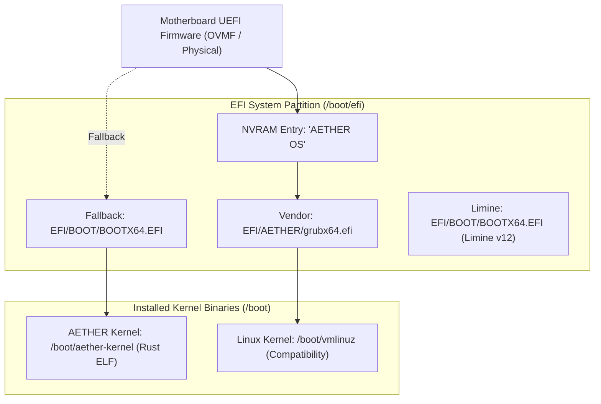

# AETHER OS — Bootloader Integration Specification

## 1. Bootloader Architecture

AETHER OS employs a dual bootloader integration strategy supporting both the **Limine Boot Protocol (Specification Revision 2)** and standard **GRUB UEFI (x86_64-efi)**.



---

## 2. Limine Boot Protocol v2 Integration

The standalone **AETHER Kernel** (`aether-kernel/`) boots directly via Limine using its higher-half 64-bit ELF protocol.

### Configuration (`/boot/limine.conf`):
```text
timeout: 3
default_entry: 1

/AETHER OS (AETHER Kernel x86_64)
    protocol: limine
    kernel_path: boot():/boot/aether-kernel

/AETHER OS (Troubleshooting & Recovery)
    protocol: limine
    kernel_path: boot():/boot/aether-kernel
```

### Deployed Binaries:
* `BOOTX64.EFI`: Limine UEFI executable placed on the ESP at `EFI/BOOT/BOOTX64.EFI`.
* `limine-uefi-cd.bin`: El Torito UEFI boot image for optical/hybrid media.
* `limine-bios-cd.bin` & `limine-bios.sys`: Stage 2 and 3 BIOS runtime for legacy compatibility.

---

## 3. GRUB UEFI (x86_64) Integration

For full hardware driver coverage and desktop compatibility during early development, the installer deploys GRUB UEFI:

1. **Chroot Binding:** Binds `/dev`, `/proc`, `/sys`, and `/run` from host into `/mnt/aether_target`.
2. **Installation Command:**
   ```bash
   chroot /mnt/aether_target grub-install \
       --target=x86_64-efi \
       --efi-directory=/boot/efi \
       --bootloader-id=AETHER \
       --recheck
   ```
3. **Fallback Binary:** Copies `EFI/AETHER/grubx64.efi` to `EFI/BOOT/BOOTX64.EFI` so systems with non-standard or buggy NVRAM firmware will still boot seamlessly.
4. **NVRAM Registration:** Invokes `efibootmgr`:
   ```bash
   efibootmgr -c -d /dev/sda -p 1 -L "AETHER OS" -l "\\EFI\\AETHER\\grubx64.efi"
   ```
5. **Configuration Generation:** Executes `update-grub` within the chroot to automatically probe and register the AETHER Kernel and any dual-boot operating systems.

---

## 4. Kernel Handoff Verification

Before completing the bootloader stage, the installer confirms:
1. `BOOTX64.EFI` or `grubx64.efi` exists and exceeds 1 KiB in size.
2. The kernel image exists in `/boot`.
3. The root filesystem UUID matches the bootloader root argument.
