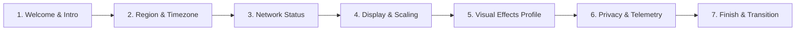

# AETHER OS — First-Boot Setup Specification

## 1. Purpose & Trigger Mechanism

The **AETHER First-Boot Setup Wizard** is a streamlined post-installation configuration utility designed to run **strictly once** on the very first boot of an installed system. It enables the user to finalize system preferences before launching into the full AETHER Aurora desktop.

### Trigger Logic
1. During Stage 12 (`FINALIZING`), the installer creates a persistent flag file:
   `/var/lib/aether-os/first-boot-pending`
2. Upon user login on the installed system, the session manager checks:
   - If running in a live session (`boot=live`), do nothing.
   - If `/var/lib/aether-os/first-boot-pending` exists (or `~/.config/aether-os/firstboot-complete` is absent), launch `/usr/local/bin/aether-firstboot`.
   - If neither condition is met, launch the normal desktop immediately.

---

## 2. Wizard Workflow & Screens

### Screen 1: Welcome & Overview
* **Displays:** AETHER OS geometric delta logo, "Welcome to Your AETHER OS", tagline, and introductory summary.
* **Purpose:** Sets the premium, frosted-glass tone for the initial user onboarding.

### Screen 2: Region, Timezone & Keyboard
* **Timezone:** Searchable dropdown populated dynamically from `/usr/share/zoneinfo/zone.tab`. System timezone is updated via `timedatectl`.
* **Keyboard Layout:** Dropdown containing standard international layouts (`us`, `gb`, `es`, `fr`, `de`, `in`, `jp`). Applied immediately via `setxkbmap`.

### Screen 3: Network Status
* **Inspection:** Queries sysfs network interfaces (`/sys/class/net/*/carrier`) in real time.
* **Display:** Informs the user whether an active Ethernet / Wi-Fi connection is detected. Reassures offline users that full setup can continue without internet access.

### Screen 4: Display Preferences & Scaling
* **Display Scaling:** Allows selecting 100% (Standard HD), 125% (Medium), or 150% (High-DPI / 4K).
* **Color Palette:** Toggle between AETHER Aurora Dark (default neon-glass) and AETHER Clean Light.

### Screen 5: Visual Effects Engine Profile
Users choose from three hardware-tailored graphics profiles:
1. **Adaptive Visual Effects (Recommended):** Continuously balances window blur, compositor opacity, and animation curves according to live RAM and GPU headroom.
2. **Balanced Visual Effects:** Preserves core fluid animations and glass window transparency while locking compositor frame times.
3. **Lightweight Mode:** Strips heavy drop-shadows and animation delays to ensure 60 FPS responsiveness on virtual machines and low-end hardware.

### Screen 6: Privacy & Telemetry Review
* **Guarantee:** Reaffirms the AETHER OS commitment to **zero tracking, zero analytics, zero telemetry, and zero advertisements**.
* **Maintenance:** Provides a toggle to enable automatic cache and temporary file cleanup on system shutdown.

### Screen 7: Completion & Launch
* **Actions on 'Finish':**
  1. Saves settings to `~/.config/aether-os/firstboot.json` and `visual-effects.json`.
  2. Creates marker `~/.config/aether-os/firstboot-complete`.
  3. Removes system flag `/var/lib/aether-os/first-boot-pending`.
  4. Spawns `aether-top-bar` and `aether-dock`, smoothly presenting the full AETHER Aurora desktop.
  5. The wizard never runs again on subsequent boots.
