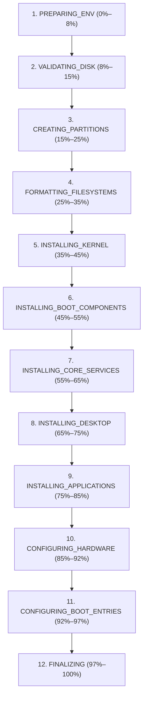

# AETHER OS — Installation Process & Pipeline Specification

## 1. Technical Overview

The AETHER OS installation pipeline is executed by the asynchronous `InstallerEngine` running in a dedicated worker thread. The engine coordinates **12 distinct, non-simulated stages**, reporting exact milestone descriptions, fractional progress (0%–100%), and streaming live output to the user interface.

---

## 2. The 12 Installation Stages



### Stage 1: Preparing Installation Environment (`PREPARING_ENV`)
* **Actions:** Validates kernel storage modules, ensures required userland utilities (`parted`, `mkfs.vfat`, `mkfs.ext4`, `unsquashfs`, `rsync`, `efibootmgr`) are loaded in the environment.
* **Safety:** Verifies that no stale mounts exist under `/mnt/aether_target`.

### Stage 2: Validating Target Disk (`VALIDATING_DISK`)
* **Actions:** Re-validates the block device node (e.g. `/dev/sda` or `/dev/nvme0n1`). Confirms physical disk size, checks write permissions, and verifies that the target is neither a loop device nor the active live installation media.

### Stage 3: Creating Partition Layout (`CREATING_PARTITIONS`)
* **Actions:** Unmounts any active partitions on the target drive, clears existing partition headers via `wipefs`, and writes a clean GPT (GUID Partition Table) using `parted`.
* **Partitions Created:**
  - Partition 1: 512 MiB EFI System Partition (`vfat`, flags: `esp`, `boot`).
  - Partition 2: Remainder (15+ GiB) as AETHER Root (`ext4`).
* **Kernel Sync:** Executes `partprobe` and `udevadm settle` to ensure the kernel registers the new partition nodes before formatting.

### Stage 4: Formatting Selected Partitions (`FORMATTING_FILESYSTEMS`)
* **Actions:** 
  - Formats Partition 1 as FAT32: `mkfs.vfat -F 32 -n AETHER-BOOT <esp_node>`.
  - Formats Partition 2 as 64-bit ext4: `mkfs.ext4 -F -O 64bit -L AETHER-OS <root_node>`.
* **UUID Resolution:** Calls `blkid` to retrieve the definitive hardware UUIDs for both partitions.
* **Mounting:** Mounts the root partition at `/mnt/aether_target` and the ESP at `/mnt/aether_target/boot/efi`.

### Stage 5: Installing AETHER Kernel (`INSTALLING_KERNEL`)
* **Actions:** Copies the standalone 64-bit Higher-Half AETHER Kernel binary (`aether-kernel` ELF) to `/mnt/aether_target/boot/aether-kernel`. Configures execution permissions and sets up the Limine boot protocol configuration (`limine.conf`).

### Stage 6: Installing Boot Components (`INSTALLING_BOOT_COMPONENTS`)
* **Actions:** Copies the base operating system filesystem to the target disk using `unsquashfs` from the live squashfs image (or an atomic `rsync` from the live root excluding virtual filesystems).

### Stage 7: Installing Core System Services (`INSTALLING_CORE_SERVICES`)
* **Actions:** Deploys foundational system services: systemd runtime, networking services, udev device rules, and audio daemons (PipeWire / ALSA).

### Stage 8: Installing Desktop Environment (`INSTALLING_DESKTOP`)
* **Actions:** Deploys the AETHER Aurora desktop shell: XFCE 4.18 core, XFWM4 theme with clean right-aligned controls, and the Adaptive Visual Effects engine.

### Stage 9: Installing Essential Applications (`INSTALLING_APPLICATIONS`)
* **Actions:** Deploys native AETHER applications: AETHER Files, AETHER Settings, AETHER Software Store, AETHER Task Manager, Security Center, and Driver Manager.

### Stage 10: Configuring Hardware & System Files (`CONFIGURING_HARDWARE`)
* **Actions:**
  - **Fstab Generation:** Writes `/mnt/aether_target/etc/fstab` with exact partition UUIDs:
    ```
    UUID=<root_uuid> /        ext4 errors=remount-ro,noatime 0 1
    UUID=<esp_uuid>  /boot/efi vfat umask=0077,noatime        0 2
    ```
  - **Hostname & Network:** Configures `/etc/hostname` and `/etc/hosts`.
  - **User Accounts:** Creates the administrative user in `/etc/passwd` and `/etc/shadow` with a salted SHA-512 password hash. Adds user to `sudo`, `audio`, `video`, `plugdev`, `netdev`, and `input` groups.
  - **Autologin:** Configures `/etc/lightdm/lightdm.conf.d/01-aether-autologin.conf` if enabled.

### Stage 11: Configuring Boot Entries (`CONFIGURING_BOOT_ENTRIES`)
* **Actions:** 
  - Binds virtual filesystems (`/dev`, `/proc`, `/sys`, `/run`) into the target chroot.
  - Runs `grub-install --target=x86_64-efi --efi-directory=/boot/efi --bootloader-id=AETHER`.
  - Creates fallback binary `EFI/BOOT/BOOTX64.EFI` on the ESP.
  - Registers the NVRAM boot entry "AETHER OS" using `efibootmgr`.
  - Generates `grub.cfg` via `update-grub`.

### Stage 12: Finalizing Installation (`FINALIZING`)
* **Actions:**
  - Touches `/var/lib/aether-os/first-boot-pending` to arm the First-Boot Setup wizard.
  - Performs post-flight verification (`installation_verification.py`).
  - Calls `sync` to flush write buffers to physical media.
  - Cleanly unmounts all target partitions.
  - Signals completion to the UI.

---

## 3. Error Handling and Recovery

If an error occurs during any stage:
1. The execution engine halts immediately to prevent data corruption.
2. The pipeline safely unmounts `/mnt/aether_target` if mounted.
3. The UI displays the exact failure message, the offending stage, and actionable recovery hints.
4. The live log stream expander opens automatically.
5. The user can launch a Rescue Shell to inspect disk health or restart the installer.
