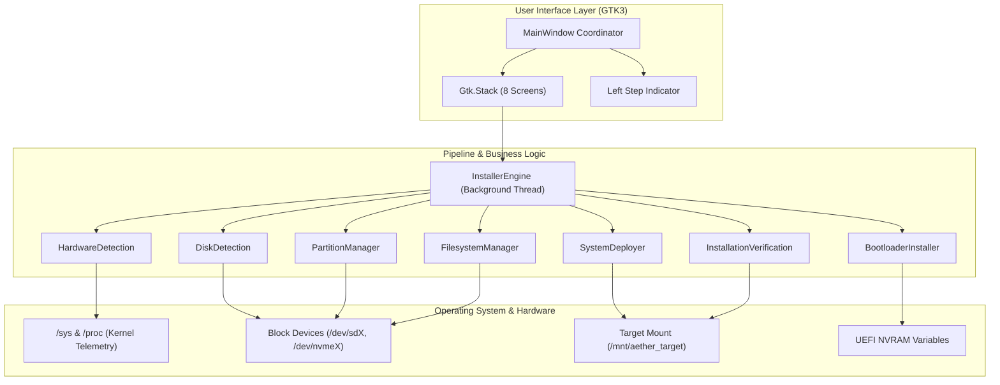

# AETHER OS — Installer Architecture Specification

## 1. System Overview

The **AETHER OS Installer** is a dedicated, full-screen graphical installation subsystem designed to guide users through the complete deployment of AETHER OS onto storage hardware. 

The installer strictly enforces the core requirement that **uninstalled boot media (ISO / USB) must NOT expose a normal live desktop**. Instead, the installation media acts as a focused, secure deployment appliance whose sole primary environment is the AETHER OS Installer.

---

## 2. Visual Identity & Design Principles

* **Brand Name:** AETHER OS
* **Tagline:** *One System. Every Workflow.*
* **Palette:** Aurora-inspired electric cyan (`#38bdf8`), vibrant purple (`#a855f7`), indigo (`#6366f1`), and deep space background (`#070814`).
* **Material Design:** Dark frosted glass containers (`rgba(19, 21, 44, 0.7)`), 1px subtle glowing borders (`rgba(99, 102, 241, 0.25)`), and 12–14px rounded corners.
* **Layout:** Full-screen responsive viewport (optimized for 1280×720 and 1920×1080) with a fixed left-hand sequential progress sidebar and a dynamic main content area.
* **Originality:** Purpose-built original geometry and controls; no imitation of third-party OS installers.

---

## 3. Subsystem Architecture

The installer is engineered with a strict separation of concerns between core hardware/storage logic, user interface controllers, and cross-cutting system services:

```
installer/
├── core/                           # System operations & hardware drivers
│   ├── hardware_detection.py       # Sysfs & procfs hardware inspection
│   ├── disk_detection.py           # Block device & partition table discovery
│   ├── partition_manager.py        # GPT/MBR partition planning & execution
│   ├── filesystem_manager.py       # FAT32 & ext4 formatters & UUID resolver
│   ├── system_deployer.py          # Filesystem deployment, user crypt & fstab
│   ├── bootloader_installer.py     # UEFI GRUB & Limine NVRAM installer
│   ├── installation_verification.py# Sanity checks & filesystem verification
│   └── installer_engine.py         # 12-stage asynchronous execution pipeline
├── ui/                             # GTK3 graphical presentation layer
│   ├── style.css                   # Aurora theme styling & glass effects
│   ├── main_window.py              # Master window & navigation coordinator
│   ├── screen_welcome.py           # Screen 1: Welcome & language
│   ├── screen_requirements.py      # Screen 2: System hardware audit
│   ├── screen_installation_type.py # Screen 3: Installation strategy & disk choice
│   ├── screen_disk_selection.py    # Screen 4: Visual partition manager
│   ├── screen_user_setup.py        # Screen 5: User accounts & SHA-512 crypt
│   ├── screen_summary.py           # Screen 6: Confirmation & destructive warnings
│   ├── screen_progress.py          # Screen 7: Live 12-stage progress & log stream
│   └── screen_completion.py        # Screen 8: Success & reboot/shutdown actions
├── services/                       # Cross-cutting support services
│   ├── logging.py                  # Thread-safe dual file & GUI log streamer
│   ├── error_handling.py           # Structured exception hierarchy & recovery hints
│   ├── localization.py             # Multi-language translation engine
│   └── accessibility.py            # High-contrast, keyboard & rescue terminal
├── tests/                          # Automated unit & integration tests
│   ├── test_hardware_detection.py
│   ├── test_disk_detection.py
│   ├── test_partition_manager.py
│   └── test_installer_engine.py
└── main.py                         # Application CLI entry point
```

---

## 4. Component Interaction Diagram



---

## 5. Security & Safety Model

1. **Destructive Operation Gates:**
   - Any wipe or repartition action requires two explicit acknowledgments: an on-page confirmation checkbox and a modal confirmation dialog.
   - The installer automatically interrogates `/run/live/medium` and `/lib/live/mount/medium` to locate the active installation USB drive and **strictly forbids writing to or erasing the boot medium**.

2. **Credential Hardening:**
   - User passwords are encrypted immediately using salted SHA-512 hashes (`$6$`) via Linux `crypt()` / `openssl`.
   - Passwords are never written to disk in plaintext, logged, or exposed in the summary screens.

3. **Verification Before Unmount:**
   - Every installation undergoes automated post-flight verification (`installation_verification.py`) checking root binaries, `/etc/fstab` UUID matches, kernel binary presence, and UEFI `BOOTX64.EFI` registration before unmounting.

---

## 6. Portability to Native AETHER Kernel

The installer's core logic is decoupled from Linux-specific runtime helpers. When the custom AETHER Kernel reaches Milestone 5 (AHCI/NVMe drivers, VFS, and userland system calls), the `core/` interfaces map directly to native kernel system calls.
