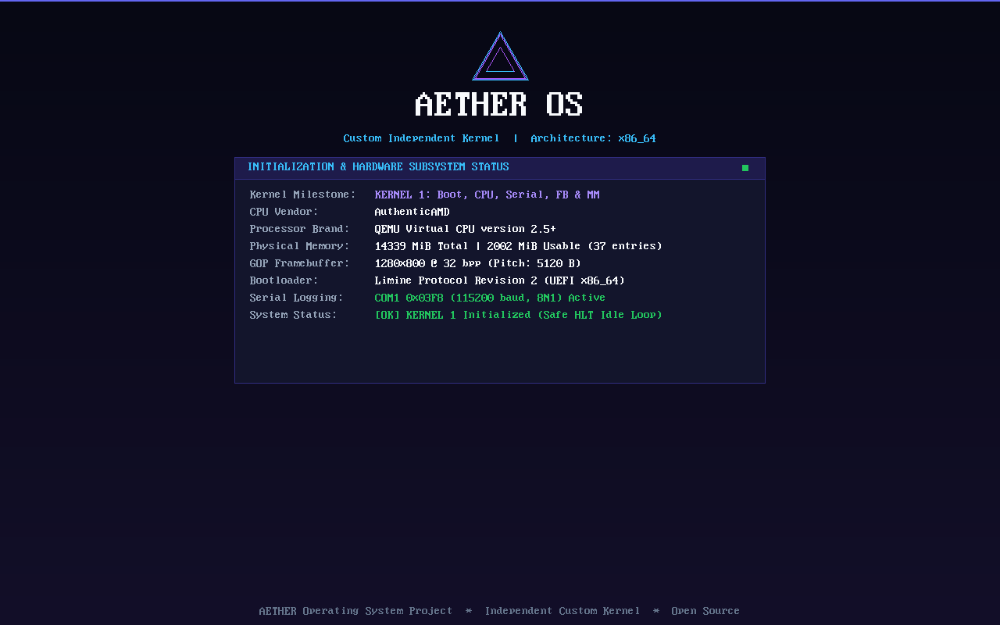

# 🌌 AETHER Kernel

### *Custom Independent Operating System Kernel for x86_64*

[-orange.svg)](https://www.rust-lang.org/)
[](#architecture)
[](https://limine-bootloader.org/)
[](KERNEL-TESTING.md)
[](Cargo.toml)

---

## 📸 Verified QEMU UEFI Boot Screen (Milestone 1)



---

## 🎯 Architectural Overview

The **AETHER Kernel** is a from-scratch, freestanding x86_64 operating system kernel written primarily in memory-safe Rust with assembly only for low-level architecture primitives. It represents the core foundation of the AETHER OS independent kernel transition, operating completely free of the Linux kernel.

### Key Characteristics:
* **Architecture:** Higher-Half 64-bit Relocatable ELF (`0xffffffff80000000`)
* **Boot Protocol:** Limine Boot Protocol (Specification Revision 2)
* **Firmware Support:** Modern UEFI (OVMF) & Legacy BIOS hybrid compatibility
* **Safety:** `#![no_std]`, safe abstractions over memory-mapped I/O and CPU registers

---

## 🚀 Milestone Status

### Milestone 0: Development Environment & Architecture ✅
* Modular Monolithic kernel architecture designed ([KERNEL-ARCHITECTURE.md](KERNEL-ARCHITECTURE.md))
* Rust `no_std` cross-compilation pipeline configured (`x86_64-unknown-none`)
* Limine bootloader integration and hybrid ISO build tooling established
* 10-phase kernel roadmap published ([KERNEL-ROADMAP.md](KERNEL-ROADMAP.md))

### Milestone 1: Boot, CPU, Serial, FB & Memory Accounting ✅
* **UEFI Boot:** Boots successfully into 64-bit long mode via OVMF and Limine
* **Handshake:** Validates Limine Base Revision 2 protocol handshake
* **CPU Management:** CPUID extraction of vendor ID (`AuthenticAMD`, `GenuineIntel`) and 48-byte brand string
* **Serial Logging:** 16550 UART COM1 driver at `0x03F8` (115200 baud, 8N1) with `serial_println!` macros
* **Physical Memory:** Real-time physical memory map parser categorizing Usable, Reserved, Reclaimable, Kernel, and Framebuffer regions
* **Direct Map:** Interrogation of Higher-Half Direct Map (HHDM) base offset
* **GOP Framebuffer:** Linear graphics driver supporting 32 bpp, arbitrary pitch, and custom color mask shifts
* **AETHER Visual Engine:** Direct drawing of deep-space background gradient, neon purple-blue geometric delta logo, title, and hardware diagnostics card
* **Safe Idle:** Safe low-power CPU idle loop (`hlt`)
* **Panic Handler:** Dual-target panic handler outputting stack context to COM1 and drawing an on-screen red warning banner

---

## 🛠️ Building and Running

### Prerequisites
* Rust toolchain (1.80+) with `x86_64-unknown-none` target:
  ```bash
  rustup target add x86_64-unknown-none
  ```
* System packages:
  ```bash
  sudo apt install -y qemu-system-x86_64 ovmf xorriso build-essential
  ```

### Build the Bootable Hybrid ISO
```bash
./scripts/build-iso.sh
```
This produces `aether-kernel.iso` and release archive in `dist/AETHER-Kernel-Milestone1-x86_64.iso`.

### Boot in QEMU
```bash
# Interactive GUI window:
./scripts/run-qemu.sh

# Headless mode with serial console output:
./scripts/run-qemu.sh --headless
```

---

## 🗺️ Kernel Roadmap

* **KERNEL 0:** Architecture, Rust toolchain, Limine bootloader, build system *(Completed)*
* **KERNEL 1:** UEFI boot, CPU init, serial COM1 logging, framebuffer splash, memory map *(Completed)*
* **KERNEL 2:** GDT, IDT, interrupt handling, PMM, VMM, 4-level paging *(Next)*
* **KERNEL 3:** Kernel heap allocator, timer interrupts (PIT/APIC), preemptive multitasking, threads
* **KERNEL 4:** User mode transition (Ring 3), system call dispatcher (`syscall`/`sysret`), address space isolation
* **KERNEL 5:** PCI bus enumeration, AHCI/NVMe storage drivers, USB HID framework, VFS
* **KERNEL 6:** Hardware graphics abstraction, 2D blitter, window compositor engine
* **KERNEL 7:** Network stack (Ethernet, ARP, IPv4, TCP/UDP, DHCP, DNS)
* **KERNEL 8:** Audio subsystem (Intel HDA), power management (ACPI shutdown/sleep)
* **KERNEL 9:** System services, application runtime, and compatibility layers

---

## 📜 Documentation

* [Architecture Evaluation & Subsystems](KERNEL-ARCHITECTURE.md)
* [Milestones & Roadmap](KERNEL-ROADMAP.md)
* [Build Instructions](BUILD-INSTRUCTIONS.md)
* [Testing Matrix & Verification Logs](KERNEL-TESTING.md)
* [Known Limitations & Milestone Boundaries](KERNEL-LIMITATIONS.md)
